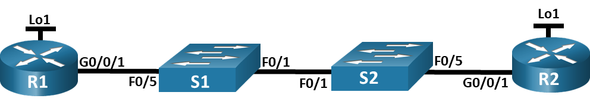

# Лабораторная работа. работа. Настройка протокола OSPFv2 для одной области

##  Топология

##  Таблица адресации

<table><thead>
    <th style="text-align: center;">Устройство</th>
    <th style="text-align: center;">Интерфейс</th>
    <th style="text-align: center;">IP-адрес</th>
    <th style="text-align: center;">Маска подсети</th>
</thead>
<tbody>
<tr>
    <th rowspan="2" style="text-align: center;">R1</th>
    <th style="text-align: center;">G0/0/1</th>
    <th style="text-align: center;">10.53.0.1</th>
    <th style="text-align: center;">255.255.255.0</th>
  </tr>
<tr>
    <th style="text-align: center;">Loopback 1</th>
    <th style="text-align: center;">176.16.1.1</th>
    <th style="text-align: center;">255.255.255.0</th>
  </tr>
<tr>
<tr>
    <th rowspan="2" style="text-align: center;">R2</th>
    <th style="text-align: center;">G0/0/1</th>
    <th style="text-align: center;">10.53.0.2</th>
    <th style="text-align: center;">255.255.255.0</th>
  </tr>
<tr>
    <th style="text-align: center;">Loopback 1</th>
    <th style="text-align: center;">192.168.1.1</th>
    <th style="text-align: center;">255.255.255.0</th>
</tr>
</tbody>
</table>

## Задачи

Часть 1. Создание сети и настройка основных параметров устройства\
Часть 2. Настройка и проверка базовой работы протокола  OSPFv2 для одной области\
Часть 3. Оптимизация и проверка конфигурации OSPFv2 для одной области\

## Выполнение работы

### Часть 1.  Настройка основного сетевого устройства

#### Шаг 1 Создаем топологию сети

#### Шаг 2 Настройка маршрутизаторов

#### Шаг 3 Настройка базовых параметров коммутаторов

### Часть 2. Настройка и проверка базовой работы протокола  OSPFv2 для одной области

#### Шаг 1 Настройте адреса интерфейса и базового OSPFv2 на каждом маршрутизаторе.

### Часть 3. Оптимизация и проверка конфигурации OSPFv2 для одной области

#### Шаг 1  Реализация различных оптимизаций на каждом маршрутизаторе.

#### Шаг 2 Проверка, что оптимизация OSPFv2 реализовалась.

