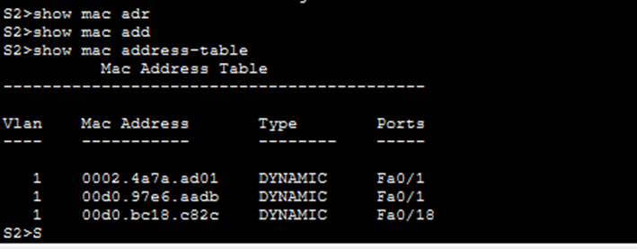
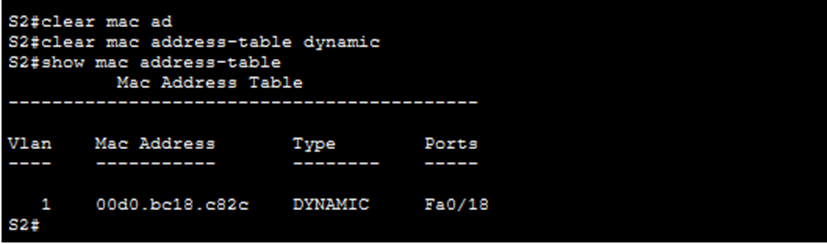
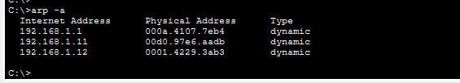
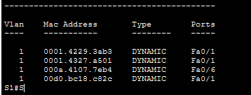

# Лабораторная работа. Просмотр таблицы MAC-aдресов коммутатора 

##  Топология

##  Таблица адресации

<table>
  <tr>
    <th style="text-align: center;">Устройство</th>
    <th style="text-align: center;">Интерфейс</th>
    <th style="text-align: center;">IP-адрес</th>
    <th style="text-align: center;">Маска подсети</th>
  </tr>
  <tr>
    <td style="text-align: center">Switch1</td>
    <td style="text-align: center">Vlan1</td>
    <td style="text-align: center">192.168.1.11</td>
    <td style="text-align: center">255.255.255.0</td>
  </tr>
  <tr>
    <td style="text-align: center">Switch 2</td>
    <td style="text-align: center">Vlan1</td>
    <td style="text-align: center">192.168.1.12</td>
    <td style="text-align: center">255.255.255.0</td>
  </tr>
  <tr>
    <td style="text-align: center">PC-A</td>
    <td style="text-align: center">NIC</td>
    <td style="text-align: center">192.168.1.1</td>
    <td style="text-align: center">255.255.255.0</td>
  </tr>
  <tr>
    <td style="text-align: center">PC-B</td>
    <td style="text-align: center">NIC</td>
    <td style="text-align: center">192.168.1.2</td>
    <td style="text-align: center">255.255.255.0</td>
</table>

## Выполнение работы

### Часть 1 Создаем и настройка сети

#### Шаг 1-4 
1. Собираем схему согласно топологии 
2. Делаем настройку PC-A и PC-B в соответствии с таблицей адрессации
3. Делаем настройку коммутатор в соответсвии с заданием и таблицей адресации
4. 
Настройка коммутатора S1 после подключения telnet:

Найстрока коммутатора S2 после подключения telnet:

### Часть 2 Изучение таблицы MAC-aдресов коммутаторов

#### Шаг 1 Запись MAC-адресов сетевых устройств

1. МAC адреса для компьютеров

Для получаем MAC-адреса PC-A используем команду в терминале: 
>ipconfig /all

Результат на скриншоте ниже

MAC-адрес компьютера PC-A: 000A.4107.7EB4 

Аналогично поступим для PC-B.

MAC-адрес компьютера PC-B: 00D0.BC18.C82C

2. MAC адрес для коммутаторов

Для их получения  в режиме EXEC через консоль коммутатора выполним команду:

>show interface F0/1

Результат на скриншоте ниже

МАС-адрес коммутатора S1 Fast Ethernet 0/1: 0002.4a7a.ad01

МАС-адрес коммутатора S2 Fast Ethernet 0/1: 0001.4327.a501

Также посмотрим MAC-адрес для интерфейса Vlan 1, на который мы назначили ip адрес в первой части работы:
 
 00d0.97e6.aadb (S1) \
 0001.4229.3ab3 (S2)

#### Шаг 2 Просмотр таблицы MAC-адресов коммутатора

Выполним подключение к S2 через консоль и в режиме EXEC выполним следующую команду:

> show mac address-table

Результат на скриншоте ниже 

В таблице записаны 3 адреса

2 адреса принадлежат порту F0/1 S1, один из них принадлежит интерфейсу Vlan1. Один адрес относится к порту F0/18 через которой идет соединение с PC-B. Теоретически интерфейсы можно было бы различить в зависимости от Vlan, которым они принадлежат, но в данной работе все обращения идут в рамках одного Vlan. Также можно было бы определить по порту, но в данном случае любые обращение на коммутатор S2 со стороны S1 или PC-A будут проходить через порт F0/1, к которому физически подключен кабель, следовательно точно соотнести интерфейсы в таком ситуациии может быть затруднительно. 

#### Шаг  3. Отчистка таблицы MAC-адресов и повторное её отображение. 

Если в  рамках той же сессии отчистить таблицу MAC-адресов через команду

> clear mac address-table dynamic

И снова её вывести мы получим результат как на скриншоте ниже:

В таблице указан только адрес PC-B, с которым в настоящий момент идет сессия. 

Если мы подождем ещё 10 секунд, то после повторного подключения появится второй адрес, который относится к порту F0/1 коммутатора S1 физически, соединенного с портом F0/1 коммутатора S2. Таким образом можем сделать вывод, что коммутатор динамически получает адрес от активных соединений, в первую очередь тех, на которых идет работа, во вторую тех, кто имеет физическую связность с коммутатором. 

#### Шаг 4. Проверка arp таблиц после выполнения ping

Через PC-B отправим ping запрос на все остальные устройства, после выполним команду:

>arp -a 

В результате у нас получилась таблица с 3 MAC-адреса, PC-A, Vlan 1 S1, Vlan 1 S2

Если после подключиться к консоли коммутатора S1 и посмотреть его таблицу MAC-адресов мы увидим следующее:

В таблице есть адреса PC-A, PC-B, Vlan 1 S2, F0/1 S2, таким образом коммутатор сохраняет проходящие через него запросы в свою таблицу. 

## Вопросы для повторения 

В сетях Ethernet данные передаются на устройства по соответствующим МАС-адресам. Для этого коммутаторы и компьютеры динамически создают ARP-кэш и таблицы МАС-адресов. Если компьютеров в сети немного, эта процедура выглядит достаточно простой. Какие сложности могут возникнуть в крупных сетях?

**Ответ**: как уже было отмечено на один физический порт в ARP таблице или MAC таблице может приходиться множество MAC-адресов от устройств, сигнал которых проходил через этот порт. При условии, что они также принадлежат одному Vlan, их будет невозможно отличить друг от друга. 