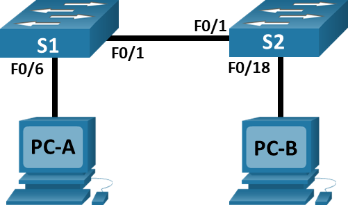
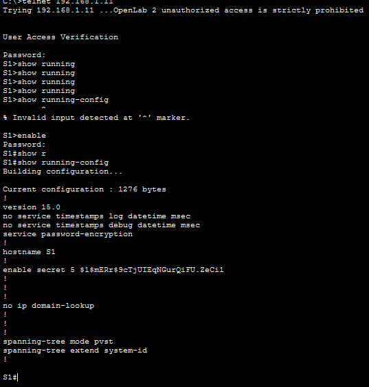
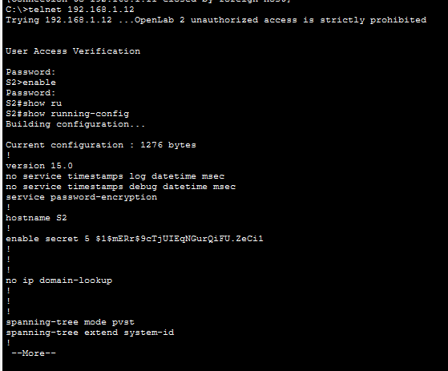
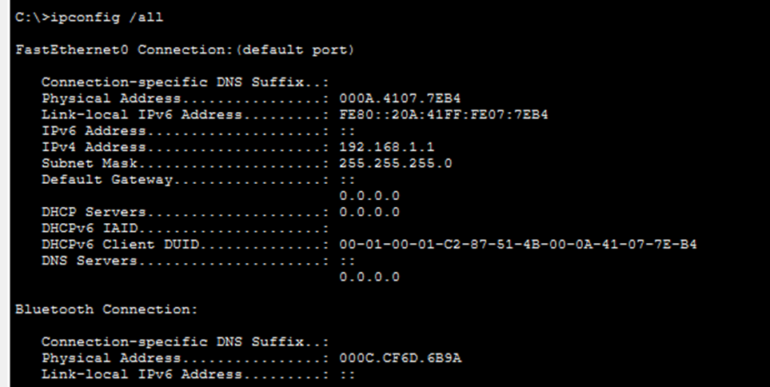
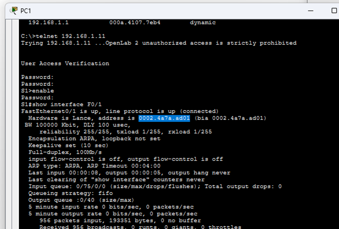

# Лабораторная работа. Просмотр таблицы MAC-aдресов коммутатора 

##  Топология

##  Таблица адресации

<table>
  <tr>
    <th style="text-align: center;">Устройство</th>
    <th style="text-align: center;">Интерфейс</th>
    <th style="text-align: center;">IP-адрес</th>
    <th style="text-align: center;">Маска подсети</th>
  </tr>
  <tr>
    <td style="text-align: center">Switch1</td>
    <td style="text-align: center">Vlan1</td>
    <td style="text-align: center">192.168.1.11</td>
    <td style="text-align: center">255.255.255.0</td>
  </tr>
  <tr>
    <td style="text-align: center">Switch 2</td>
    <td style="text-align: center">Vlan1</td>
    <td style="text-align: center">192.168.1.12</td>
    <td style="text-align: center">255.255.255.0</td>
  </tr>
  <tr>
    <td style="text-align: center">PC-A</td>
    <td style="text-align: center">NIC</td>
    <td style="text-align: center">192.168.1.1</td>
    <td style="text-align: center">255.255.255.0</td>
  </tr>
  <tr>
    <td style="text-align: center">PC-B</td>
    <td style="text-align: center">NIC</td>
    <td style="text-align: center">192.168.1.2</td>
    <td style="text-align: center">255.255.255.0</td>
</table>

## Выполнение работы

### Часть 1 Создаем и настройка сети

#### Шаг 1-4 
1. Собираем схему согласно топологии 
2. Делаем настройку PC-A и PC-B в соответствии с таблицей адрессации
3. Делаем настройку коммутатор в соответсвии с заданием и таблицей адресации
4. 
Настройка коммутатора S1 после подключения telnet:

Найстрока коммутатора S2 после подключения telnet:

### Часть 2 Изучение таблицы MAC-aдресов коммутаторов

#### Шаг 1 Запись MAC-адресов сетевых устройств

1. МAC адреса для компьютеров

Для получаем MAC-адреса PC-A используем команду в терминале: 
>ipconfig /all

Результат на скриншоте ниже

MAC-адрес компьютера PC-A: 000A.4107.7EB4 

Аналогично поступим для PC-B.

MAC-адрес компьютера PC-B: 00D0.BC18.C82C

2. MAC адрес для коммутаторов

Для их получения  в режиме EXEC через консоль коммутатора выполним команду:

>show interface F0/1

Результат на скриншоте ниже

МАС-адрес коммутатора S1 Fast Ethernet 0/1: 0002.4a7a.ad01

МАС-адрес коммутатора S2 Fast Ethernet 0/1: 0001.4327.a501

Также посмотрим MAC-адрес для интерфейса Vlan 1, на который мы назначили ip адрес в первой части работы:
 
 00d0.97e6.aadb (S1) \
 0001.4229.3ab3 (S2)

