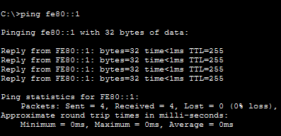
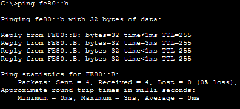
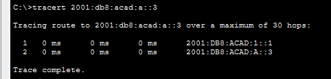
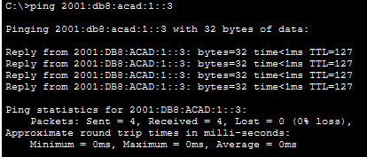
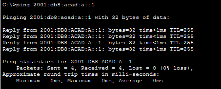

# Лабораторная работа. Настройка IPv6-адресов на сетевых устройствах 

##  Топология

##  Таблица адресации

<table><thead>
    <th style="text-align: center;">Устройство</th>
    <th style="text-align: center;">Интерфейс</th>
    <th style="text-align: center;">IPv6-адрес</th>
    <th style="text-align: center;">Link local IPv6-адрес</th>
    <th style="text-align: center;">Длина префикса</th>
    <th style="text-align: center;">Шлюз по умолчанию</th>
</thead>
<tbody>
  <tr>
    <th rowspan="2" style="text-align: center;">R1 </th>
    <th style="text-align: center;">G0/0/0</th>
    <th style="text-align: center;">2001:db8:acad:a::1</th>
    <th style="text-align: center;">fe80::1</th>
    <th style="text-align: center;">64</th>
    <th style="text-align: center;">-</th>
  </tr>
  <tr>
    <td style="text-align: center">G0/0/1</td>
    <td style="text-align: center">2001:db8:acad:1::1 </td>
    <td style="text-align: center">fe80::1</td>
    <th style="text-align: center;">64</th>
    <th style="text-align: center;">-</th>
  </tr>
  <tr>
    <td style="text-align: center">S1</td>
    <td style="text-align: center">Vlan1</td>
    <td style="text-align: center">2001:db8:acad:1::b</td>
    <td style="text-align: center">fe80::b</td>
    <th style="text-align: center;">64</th>
    <th style="text-align: center;">-</th>
  </tr>
  <tr>
    <td style="text-align: center">PC-A</td>
    <td style="text-align: center">NIC</td>
    <td style="text-align: center">2001:db8:acad:1::3</td>
    <td style="text-align: center">SLACC</td>
    <th style="text-align: center;">64</th>
    <th style="text-align: center;">fe80::1</th>
  </tr>
  <tr>
    <td style="text-align: center">PC-B</td>
    <td style="text-align: center">NIC</td>
    <td style="text-align: center">2001:db8:acad:a::3</td>
    <td style="text-align: center">SLACC</td>
    <th style="text-align: center;">64</th>
    <th style="text-align: center;">fe80::1</th>
</tbody>
</table>

## Задачи

Часть 1. Настройка топологии и конфигурация основных парамтеров маршрутизатора и коммутатора\
Часть 2. Ручная настройка IPv6-адресов\
Часть 3. Проверка сквозного соединения

## Выполнение работы

### Часть 1. Настройка топологии и конфигурация основных параметров маршрутизатора и коммутатора

#### Шаг 1 Настройка маршрутизатора

#### Шаг 2 Настройка коммутатора

### Часть 2. Ручная настройка IPv6-адресов

#### Шаг 1 Назначение IPv6-адреса интерфейсам Ethernet на R1

Какие группы многоадресной рассылки назначены интерфейсу G0/0/0?\
**Ответ:** После настройки всех адресов и включения маршрутизации на роутере, на интерфейсе назначены 3 группы:\
 - FF02::1 - группа для всех GUA\
 - FF02::2 - группа для всех маршрутизаторов IPv6\
 - FF02::1:FF00:1 - группа для GUA, который был назначен на интерфейс

#### Шаг 2 Активация IPv6-маршрутизацию на R1

Активация маршрутизации происходит в режиме глобальной конфигураци с помощью команды
>ipv6 unicast-routing

В результате PC-B, если на нем настроена автоматическая конфигурация IPv6 получит с помощью SLAAC глобальный адрес и шлюз по умолчанию. Адрес состоит из глобального префикса, который дал ему маршрутизатор и части взятой из link-local адреса компьютера. Link-local адрес в свою очередь получен с помощью метода EUI64, то есть через модификацию MAC-адреса сетевой карты. 

Итоговая конфигурация маршрутизатора представлена по [ссылке](config/R1)

#### Шаг  3. Назначение IPv6-адресов интерфейсу управления (SVI) на S1

Итоговая конфигурация коммутатора представлена по [ссылке](config/S1)

#### Шаг 4. Назначение компьютерам статических IPv6-адресов

### Часть 3 проверка сквозного подключения

Запрос c PC-A на G0/0/1 на R1

Запрос на S1 с PC-A

Запрос tracert с PC-A на PC-B

Запрос с PC-B на PC-A

Запрос с PC-B на интерфейс G0/0/0 R1

Сквозное подключение работает между всеми устройствами. Сеть настроена верно.

## Вопросы для повторения 

1. Почему обоим интерфейсам Ethernet на R1 можно назначить один и тот же локальный адрес канала — FE80::1?\
**Ответ**: Link-local адрес используется в рамках одной локальной сети, поэтому одинаковый адрес можно настроить на 2 разных интерфейса маршрутизатора, потому что за ними закреплены разные сети. 
2. Какой идентификатор подсети в индивидуальном IPv6-адресе 2001:db8:acad::aaaa:1234/64?\
**Ответ**: 2001:db8:acad::aaaa
