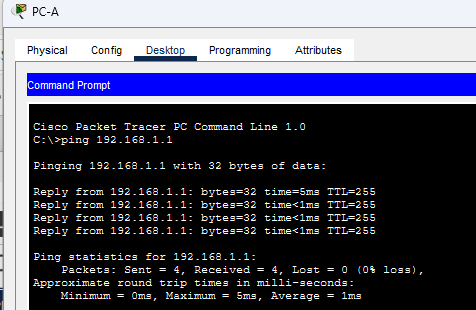
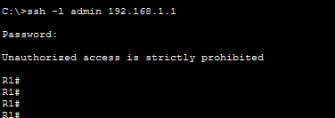
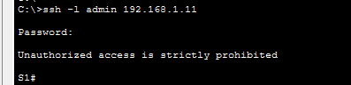
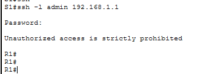

# Лабораторная работа. Доступ к сетевым устройствам по протоколу SSH

##  Топология

##  Таблица адресации

<table><thead>
    <th style="text-align: center;">Устройство</th>
    <th style="text-align: center;">Интерфейс</th>
    <th style="text-align: center;">IP-адрес</th>
    <th style="text-align: center;">Маска подсети</th>
    <th style="text-align: center;">Шлюз по умолчанию</th>
</thead>
<tbody>
  <tr>
    <th style="text-align: center;">R1 </th>
    <th style="text-align: center;">G0/0/1</th>
    <th style="text-align: center;">192.168.1.1</th>
    <th style="text-align: center;">255.255.255.0</th>
    <th style="text-align: center;">-</th>
    
  </tr>
  <tr>
    <td style="text-align: center">S1</td>
    <td style="text-align: center">VLAN 1</td>
    <td style="text-align: center">192.168.1.11</td>
    <th style="text-align: center;">255.255.255.0</th>
    <th style="text-align: center;">192.168.1.1</th>
  </tr>
  <tr>
    <td style="text-align: center">PC-A</td>
    <td style="text-align: center">NIC</td>
    <td style="text-align: center">192.168.1.3</td>
    <td style="text-align: center">255.255.255.0</td>
    <th style="text-align: center;">192.168.1.1</th>
  </tr>
</tbody>
</table>

## Задачи

Часть 1. Настройка основных параметров устройства\
Часть 2. Настройка маршрутизатора для доступа по протоколу SSH\
Часть 3. Настройка коммутатора для доступа по протоколу SSH\
Часть 4. SSH через интерфейс командной строки (СLI) коммутатора

## Выполнение работы

### Часть 1. Настройка основных параметров устройств

#### Шаг 1 Создаем топологию сети

#### Шаг 2 Выполнение инициализации и перезагрузки маршрутизатора и коммутатора

#### Шаг 3 Настройка маршрутизатора 

#### Шаг 4 Настройка PC-A

#### Шаг 5 Проверка подключения к сети

Проверка подключения PC-A к R1: 

Конфигурации оборудования: [S1](config/S1_part1) [R1](config/R1_part1)

### Часть 2. Настройка маршрутизатора для доступа по протоколу SSH

#### Шаг 1 Настройка аутентификации устройств

#### Шаг 2 Создание ключа шифрования с указанием его длины

#### Шаг  3 Создание имени пользователя в локальной базе учетных записей

#### Шаг 4 Активация протокола SSH на линиях VTY

#### Шаг 5 Сохранение текущей конфигурации в файл загрузочной конфигурации

**Пример выполнения шагов**
>R1#conf t\
R1(config)#ip domain-name lab-5.com ##Шаг 1
\  
R1(config)#crypto key generate rsa ##Шаг 2\
The name for the keys will be: R1.lab-5.com\
Choose the size of the key modulus in the range of 360 to 4096 for your
  General Purpose Keys. Choosing a key modulus greater than 512 may take
  a few minutes.
How many bits in the modulus [512]: 2048\
% Generating 2048 bit RSA keys, keys will be non-exportable...[OK]\
*Mar 1 0:33:34.448: %SSH-5-ENABLED: SSH 1.99 has been enabled
\
R1(config)#username admin privilege 15 secret Adm1nP@55 ##Шаг 3\
R1(config)#line vty 0 4 ##Шаг 4\
R1(config-line)#transport input all\
R1(config-line)#login local   \
R1(config)#ip ssh version 2\
R1(config)#exit\
R1#copy running-config startup-config ##Шаг 5

#### Шаг 6 Установка соединения с маршрутизатором по протоколу SSH

Подключение к маршрутизатору по SSH: \

Соединение установлено успешно

Конфигурация маршрутизатора [R1](config/R1_final)

### Часть 3 Настройка коммутатора для доступа по протоколу SSH

#### Шаг 1 Настройка основных параметров коммутатора

#### Шаг 2 Настройка коммутатора для соединения по протоколу SSH

Настройка выполняется аналогичным образом с маршрутизатором за исключением данных аутентификации:

Имя домена: lab-5_switch.com

Длина ключа: 2048

Имя пользователя: admin 

Уровень привелигии: 15 (максимальный)

Пароль пользователя: aDm1n#44

#### Шаг 3 Установка соединения с коммутатором по протоколу SSH

Проверка подключения: \
 

Подключения прошло успешно

Конфигурация коммутатора [S1](config/S1_final)

### Часть 4. Настройка протокола SSH с испрользованием интерфейса командной строки (CLI) коммутатора

#### Шаг 1 Просмотр доступных параметров для клиента SSH в Cisco IOS

#### Шаг 2 Установка с коммутатора S1 соединения с маршрутизатором R1 по протоколу SSH. 

Подключение по SSH прошло успешно: \

Комбинация клавиш **Ctrl+Shift+6** не работает в моей версии Cisco PT, поэтому самостоятельно проверить её работу не удалось. Выход из сессии через exit работает. 

## Вопросы для повторения 

Как предоставить доступ к сетевому устройству нескольким пользователям, у каждого из которых есть собственное имя пользователя?\
**Ответ**: Необходимо задать этих пользователей с паролями на нужное количество интерфейсов VTY, тем самым обеспечив нужно количество одновременно подключенных пользователей. 
