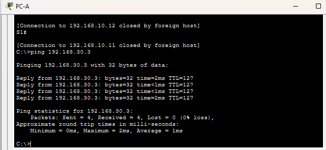
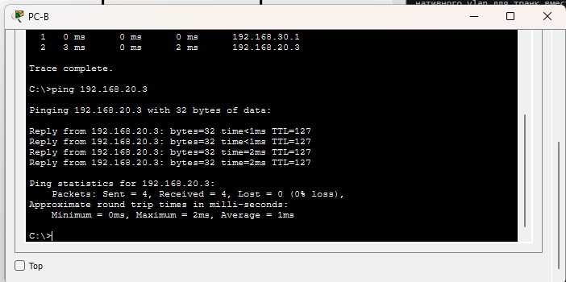

# Лабораторная работа. Внедрение маршрутизации между виртуальными локальными сетями

##  Топология

##  Таблица адресации

<table><thead>
    <th style="text-align: center;">Устройство</th>
    <th style="text-align: center;">Интерфейс</th>
    <th style="text-align: center;">IP-адрес</th>
    <th style="text-align: center;">Маска подсети</th>
    <th style="text-align: center;">Шлюз по умолчанию</th>
</thead>
<tbody>
  <tr>
    <th rowspan="4" style="text-align: center;">R1 </th>
    <th style="text-align: center;">G0/0/1.10</th>
    <th style="text-align: center;">192.168.10.1</th>
    <th style="text-align: center;">255.255.255.0</th>
    <th rowspan="4" style="text-align: center;">-</th>
  </tr>
  <tr>
    <td style="text-align: center">G0/0/1.20</td>
    <td style="text-align: center">192.168.20.1</td>
    <td style="text-align: center;">255.255.255.0</td>
  </tr>
  <tr>
    <td style="text-align: center">G0/0/1.30</td>
    <td style="text-align: center">192.168.30.1</td>
    <td style="text-align: center">255.255.255.0</td>
  </tr>
  <tr>
    <td style="text-align: center">G0/0/1.1000</td>
    <td style="text-align: center">-</td>
    <td style="text-align: center">-</td>
  </tr>
   <tr>
    <td style="text-align: center;">S1</td>
    <td style="text-align: center">VLAN 10</td>
    <td style="text-align: center">192.168.10.11</td>
    <td style="text-align: center">255.255.255.0</td>
    <td style="text-align: center;">192.168.10.1</td>
  </tr>
   <tr>
    <td style="text-align: center;">S2 </td>
    <td style="text-align: center">VLAN 10</td>
    <td style="text-align: center">192.168.10.12</td>
    <td style="text-align: center">255.255.255.0</td>
    <td style="text-align: center;">192.168.10.1</td>
  </tr>
   <tr>
    <td style="text-align: center;">PC-A</td>
    <td style="text-align: center">NIC</td>
    <td style="text-align: center">192.168.20.3</td>
    <td style="text-align: center">255.255.255.0</td>
    <td style="text-align: center;">192.168.20.1</td>
  </tr>
   <tr>
    <td style="text-align: center;">PC-B</td>
    <td style="text-align: center">NIC</td>
    <td style="text-align: center">192.168.30.3</td>
    <td style="text-align: center">255.255.255.0</td>
    <td style="text-align: center;">192.168.30.1</td>
  </tr>
</tbody>
</table>

##  Таблица VLAN

<table><thead>
    <th style="text-align: center;">VLAN</th>
    <th style="text-align: center;">Имя</th>
    <th style="text-align: center;">Назначенный интерфейс</th>
</thead>
<tbody>
  <tr>
    <th style="text-align: center;">10</th>
    <th style="text-align: center;">Управление</th>
    <th style="text-align: center;">S1: VLAN 10

 S2: VLAN 10</th>
  </tr>
  <tr>
    <td style="text-align: center">20</td>
    <td style="text-align: center">Sales</td>
    <td style="text-align: center;">S1: F0/6</td>
  </tr>
  <tr>
    <td style="text-align: center">30</td>
    <td style="text-align: center">Operations</td>
    <td style="text-align: center">S2: F0/18</td>
  </tr>
  <tr>
    <td style="text-align: center">999</td>
    <td style="text-align: center">Parking_Lot</td>
    <td style="text-align: center">C1: F0/2-4, F0/7-24, G0/1-2

C2: F0/2-17, F0/19-24, G0/1-2
</td>
  </tr>
   <tr>
    <td style="text-align: center">1000</td>
    <td style="text-align: center">Собственная</td>
    <td style="text-align: center">-</td>
  </tr>
</tbody>
</table>

## Задачи

Часть 1. Создание сети и настройка основных параметров устройства\
Часть 2. Создание сетей VLAN и назначение портов коммутатора\
Часть 3. Настройка транка 802.1Q между коммутаторами\
Часть 4. Настройка маршрутизации между сетями VLAN\
Часть 5. Проверка, что маршрутизация между VLAN работает

## Выполнение работы

### Часть 1. Создание сети и настройка основных параметров устройства

#### Шаг 1 Создаем топологию сети

#### Шаг 2 Настройка маршрутизатора

#### Шаг 3 Настройка коммутаторов

#### Шаг 4 Настройка ПК

[Результат настройки R1](config/R1_part1)

[Результат настройки S1](config/S1_part1)

[Результат настройки S2](config/S2_part1)

### Часть 2. Создание сетей VLAN и назначение портов коммутатора

#### Шаг 1 Создание сетей VLAN на коммутаторах

**Пример создания VLAN**

>conf t\
!\
vlan 10 ## создание vlan 10\
!\
name Management ## назначение имени Management для vlan 10\
!\
end ## выход из режима настройки терминала

#### Шаг 2 Назначение сетей VLAN на соответствующие интерфейсы коммутатора

**Пример назначение VLAN на интерфейсы**

>conf t\
!\
interface range f0/2-4,f0/7-24, g0/1-2 ##выбор группы интерфейсов\
!\
switchport mode access ##перевод интерфейсов в режим access\
!\
switchport access vlan 999 ##назначение интерфейсов на Vlan 999\
!\
shutdown ### административное выключение терминалов\
!\
end ### выход из режима настройки терминала

### Часть 3 Настройка транка 802.1Q между коммутаторами

#### Шаг 1 Настройка магистрального интерфейса F0/1 на коммутаторах S1 и S2

**Пример настройки trunk порта**

> conf t\
!\
 interface range f0/1\
 !\
switchport mode trunk ##перевод интерфейса в режим trunk\
!\
switchport trunk allowed vlan 10,20,30,1000 ##назначение разрешенных vlan для прохождения через trunk\
!\
switchport trunk native vlan 1000 ##назначение нативного vlan для транк вместо дефолтного vlan 1\
!\
end ### выход из режима настройки терминала

#### Шаг 2 Настройка магистрального интерфейс F0/5 на коммутаторе S1

[Результат настройки S1](config/S1_final)

[Результат настройки S2](config/S2_final)

### Часть 4. Настройка маршрутизации между сетями VLAN

#### Шаг 1 Настройка маршрутизатора

**Пример настройки интерфейса на маршрутизаторе**

> conf t\
!\
 interface range G0/0/1.10\
 !\
Description default gateway for VLAN 10 ##описание назначение интерфейса\
!\
encapsulation dot1Q 10 ##назначение механизма тегирования трафика и выбор значения метки\
!\
ip add 192.168.10.1 255.255.255.0 ##назначение адреса на интерфейс\
!\
end ### выход из режима настройки терминала

[Результат настройки R1](config/R1_final)

### Часть 5.  Проверка, что маршрутизация между VLAN работает

#### Шаг 1 Выполнение тестов c PC-A

Выполнение эхо-запроса с PC-A на PC-B:

#### Шаг 2 Выполнение тестов с PC-B

Выполнение эхо-запроса с PC-B на PC-А:

Эхо запросы проходят в обе стороны, следовательно сеть настроена правильно. 