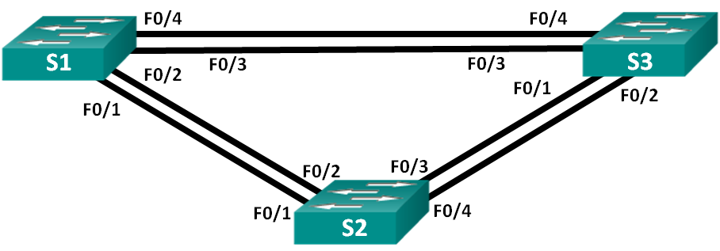
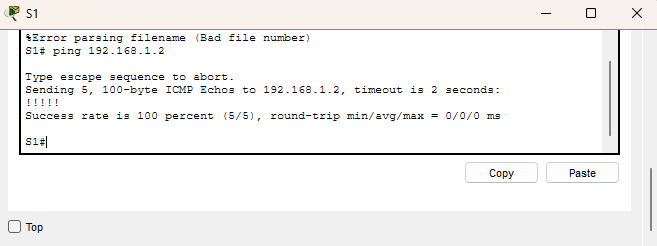
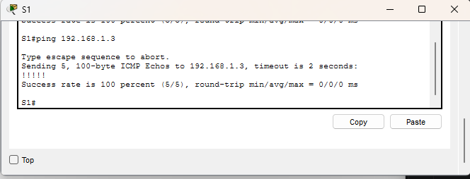
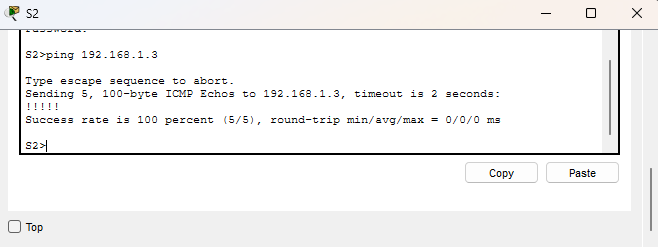
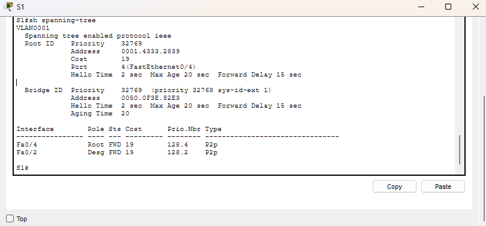
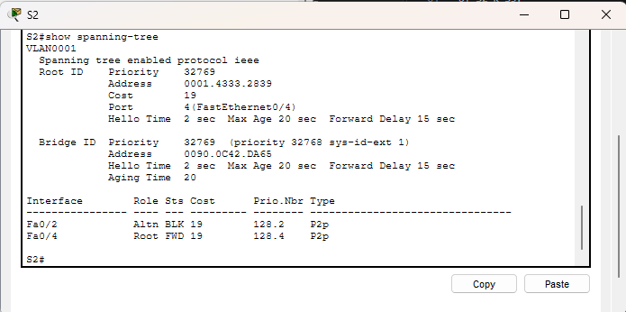
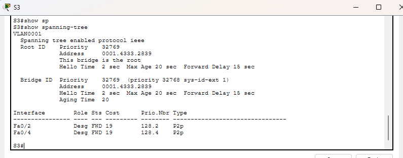
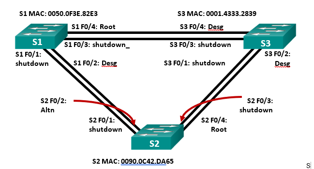
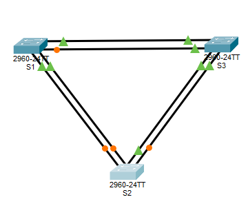

# Лабораторная работа. Развертывание коммутируемой сети с резервными каналами

##  Топология

##  Таблица адресации

<table><thead>
    <th style="text-align: center;">Устройство</th>
    <th style="text-align: center;">Интерфейс</th>
    <th style="text-align: center;">IP-адрес</th>
    <th style="text-align: center;">Маска подсети</th>
</thead>
<tbody>
  <tr>
    <th style="text-align: center;">S1</th>
    <th style="text-align: center;">VLAN1</th>
    <th style="text-align: center;">192.168.1.1</th>
    <th style="text-align: center;">255.255.255.0</th>
  </tr>
  <tr>
    <th style="text-align: center;">S1</th>
    <th style="text-align: center;">VLAN1</th>
    <th style="text-align: center;">192.168.1.2</th>
    <th style="text-align: center;">255.255.255.0</th>
  </tr>
  <tr>
    <th style="text-align: center;">S1</th>
    <th style="text-align: center;">VLAN1</th>
    <th style="text-align: center;">192.168.1.3</th>
    <th style="text-align: center;">255.255.255.0</th>
  </tr>
</tbody>
</table>

## Задачи

Часть 1. Создание сети и настройка основных параметров устройства\
Часть 2. Выбор корневого моста\
Часть 3. Наблюдение за процессом выбора протоколом STP порта, исходя из стоимости портов\
Часть 4. Наблюдение за процессом выбора протоколом STP порта, исходя из приоритета портов\

## Выполнение работы

### Часть 1. Создание сети и настройка основных параметров устройства

#### Шаг 1 Создаем топологию сети

#### Шаг 2 Инициализация и перезагрузка коммутаторов

#### Шаг 3 Настройка базовых параметров коммутаторов

[Пример настройки коммутатора](configs/S1_part1)

#### Шаг 4 Проверка связи

От S1 к S2:

От S1 к S3:

От S2 к S3:

### Часть 2. Определение корневого моста

#### Шаг 1 Отключение всех портов на коммутаторах

#### Шаг 2 Настройка подключенных портов в качестве транковых

#### Шаг 3 Включение портов F0/2 и F0/4 на всех коммутаторах 

#### Шаг 4 Отображение данных протокола spanning-tree

S1 spanning-tree:

S2 spanning-tree:

S3 spanning-tree:

Ответы на вопросы. 

1. Какой коммутатор является корневым мостом? \
  **Ответ**: коммутатор S3, коммутатор, который выбирается в качестве отправного в протоколе STP для избежания возникновения петель коммутации. 
2. Почему этот коммутатор был выбран протоколом spanning-tree в качестве корневого моста? \
  **Ответ**: Коммутатор был выбран из-за наименьшего MAC-адреса
3. Какие порты на коммутаторе являются корневыми портами? \
  **Ответ**: корневые порты назначаются на не корноневом мосте, как кратчайший путь до корневого моста
4. Какие порты на коммутаторе являются назначенными портами? \
  **Ответ**: назначенные порты - это порты на корневом коммутаторе, отвечающие за пересылку трафика вниз по дереву
5. Какой порт отображается в качестве альтернативного и в настоящее время заблокирован? \
  **Ответ**: В настоящий момент момент заблокированным портом явлется порт F0/2 на коммутаторе S2
6. Почему протокол spanning-tree выбрал этот порт в качестве невыделенного (заблокированного) порта?\
  **Ответ**: Это порт не является корневым, так как не кратчайший до корневого моста и по сравнению с портом на коммутаторе S1 у него меньший приоритет (больше MAC-адрес)

### Часть 3 Наблюдение за процессом выбогра протоколом STP порта, исходя из стоимости портов

#### Шаг 1 Определие коммутатора с заблокированным протом. 

Заблокированный порт находится на коммутаторе S2 при выполнении show spanning-tree порт F0/2 подписан как Altn и заблокирован на графическом отображении топологии

#### Шаг 2 Изменение стоимости порта. 

**Пример изменения стоимости порта**

> conf t\
!\
 interface range f0/2\
 !\
spanning-tree vlan 1 cost 18##изменение стоимости порта с 19 на 18\
!\
end ### выход из режима настройки терминала

#### Шаг 3 Просмотр изменения протокола spanning-tree

После изменение стоимости порта конфигурация STP сети изменилась. Порт F0/2 на коммутаторе S1 был переведен в режим альтернативного порта, а ранее заблокированный порт F0/2 на коммутаторе S2 стал выделенным

#### Шаг 4 Удаление изменений стоимости порта

Удалим изменение стоимости выполнив команду в режиме конфигурации интерфейса f0/2
>no spanning-tree vlan 1 cost 18

Конфигурация портов вернулась к изначальной. При одинаковой стоимости и приоритете выбор порта для блокировки определялся через MAC-адрес, после уменьшения стоимости порта он был выбран как выделенный. 

### Часть 4. Наблюдение за процессом выбора протоколом STP порта, исходя из приоритета портов
 
 После включения портов f0/1 и f0/3 схема приобрела вид:

 

Конфигурации коммутаторов:
[S1](configs/S1__final)
[S2](configs/S2_final)
[S3](configs/S3_final)

На каждом из коммутаторе некорневого моста в качестве корневого порта выбран один из двух портов физически связанный с физическим маршрутом к коммутатору S3 (корневой мост) и обладающий меньшим номером (F0/3)

## Вопросы для повторения 

1. Какое значение протокол STP использует первым после выбора корневого моста, чтобы определить выбор порта? \
  **Ответ**: протокол STP смотрит на наименьшую скорость корневого пути 
2. Если первое значение на двух портах одинаково, какое следующее значение будет использовать протокол STP при выборе порта? \
  **Ответ**: При одинаковых значениях, сравнивается BID двух коммутаторов 
3. Если оба значения на двух портах равны, каким будет следующее значение, которое использует протокол STP при выборе порта? \
  **Ответ**: Далее сравнивается параметр приоритетов портов 
  
  