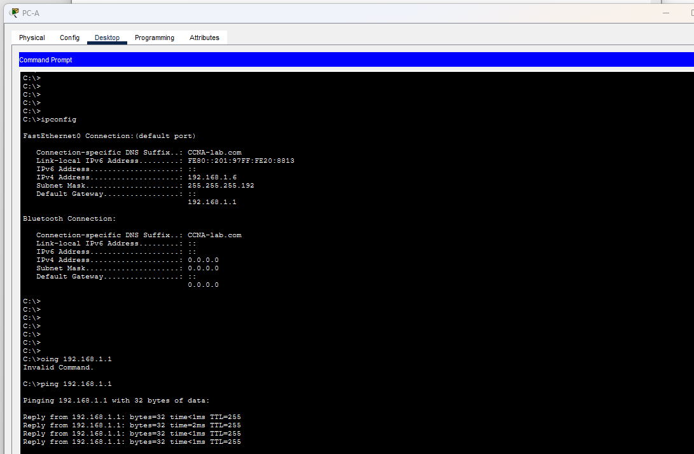
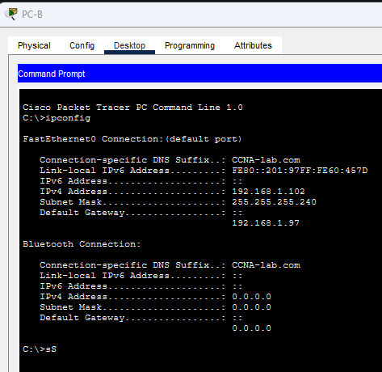
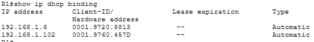

# Лабораторная работа. Реализация DHCPv4

##  Топология

##  Таблица адресации

<table><thead>
    <th style="text-align: center;">Устройство</th>
    <th style="text-align: center;">Интерфейс</th>
    <th style="text-align: center;">IP-адрес</th>
    <th style="text-align: center;">Маска подсети</th>
    <th style="text-align: center;">Шлюз по умолчанию</th>
</thead>
<tbody>
  <tr>
    <th rowspan="5" style="text-align: center;">R1 </th>
    <th style="text-align: center;">G0/0/0</th>
    <th style="text-align: center;">10.0.0.1</th>
    <th style="text-align: center;">255.255.255.252</th>
    <th rowspan="5" style="text-align: center;">-</th>
  </tr>
  <tr>
    <td style="text-align: center">G0/0/1</td>
    <td style="text-align: center">-</td>
    <td style="text-align: center;">-</td>
  </tr>
  <tr>
    <td style="text-align: center">G0/0/1.100</td>
    <td style="text-align: center"></td>
    <td style="text-align: center"></td>
  </tr>
  <tr>
    <td style="text-align: center">G0/0/1.200</td>
    <td style="text-align: center"></td>
    <td style="text-align: center"></td>
  </tr>
   <tr>
    <td style="text-align: center">G0/0/1.1000</td>
    <td style="text-align: center">-</td>
    <td style="text-align: center">-</td>
  </tr>
   <tr>
    <td rowspan="2" style="text-align: center;">R2 </td>
    <td style="text-align: center">G0/0/0</td>
    <td style="text-align: center">10.0.0.2</td>
    <td style="text-align: center">255.255.255.252</td>
    <td rowspan="2" style="text-align: center;">-</td>
  </tr>
   <tr>
    <td style="text-align: center">G0/0/1</td>
    <td style="text-align: center"></td>
    <td style="text-align: center"></td>
  </tr>
   <tr>
    <td style="text-align: center;">S1</td>
    <td style="text-align: center">VLAN 200</td>
    <td style="text-align: center"></td>
    <td style="text-align: center"></td>
    <td style="text-align: center;"></td>
  </tr>
  <tr>
    <td style="text-align: center;">S2</td>
    <td style="text-align: center">VLAN 1</td>
    <td style="text-align: center"></td>
    <td style="text-align: center"></td>
    <td style="text-align: center;"></td>
  </tr>
  <tr>
    <td style="text-align: center;">PC-A</td>
    <td style="text-align: center">NIC</td>
    <td style="text-align: center">DHCP</td>
    <td style="text-align: center">DHCP</td>
    <td style="text-align: center;">DHCP</td>
  </tr>
  <tr>
    <td style="text-align: center;">PC-B</td>
    <td style="text-align: center">NIC</td>
    <td style="text-align: center">DHCP</td>
    <td style="text-align: center">DHCP</td>
    <td style="text-align: center;">DHCP</td>
  </tr>
</tbody>
</table>

##  Таблица VLAN

<table><thead>
    <th style="text-align: center;">VLAN</th>
    <th style="text-align: center;">Имя</th>
    <th style="text-align: center;">Назначенный интерфейс</th>
</thead>
<tbody>
  <tr>
    <th style="text-align: center;">10</th>
    <th style="text-align: center;">Нет</th>
    <th style="text-align: center;">S1: F0/18</th>
  </tr>
  <tr>
    <td style="text-align: center">20</td>
    <td style="text-align: center">Клиенты</td>
    <td style="text-align: center;">S1: F0/6</td>
  </tr>
  <tr>
    <td style="text-align: center">30</td>
    <td style="text-align: center">Управление</td>
    <td style="text-align: center">S1: VLAN 200</td>
  </tr>
  <tr>
    <td style="text-align: center">999</td>
    <td style="text-align: center">Parking_Lot</td>
    <td style="text-align: center">S1: F0/1-4, F0/7-24, G0/1-2
</td>
  </tr>
   <tr>
    <td style="text-align: center">1000</td>
    <td style="text-align: center">Собственная</td>
    <td style="text-align: center">-</td>
  </tr>
</tbody>
</table>

## Задачи

Часть 1. Создание сети и настройка основных параметров устройства\
Часть 2. Настройка и проверка двух серверов DHCPv4 на R1\
Часть 3. Настройка и проверка DHCP-ретрансляции на R2\

## Выполнение работы

### Часть 1. Создание сети и настройка основных параметров устройства

#### Шаг 1 Создание схемы адресации

Требуется разбить подсеть 192.168.1.0/24 на сегменты адресов

1. Подсеть A на клиентской VLAN на R1 - 58 хостов. 

Сетевой адрес: 192.168.1.0\
Первый адрес для R1 G0/0/1.100: 192.168.1.1\
Маска: 26, 255.255.255.192

2. Подсеть B на управляющей VLAN на R1 - 28 хостов.

Сетевой адрес: 192.168.1.64\
Первый адрес для R1 G0/0/1.200: 192.168.1.65\
Второй адрес для S1 VLAN 200: 192.168.1.66\
Шлюз по умолчанию для S1: 192.168.1.65\
Маска: 27, 255.255.255.224

3. Подсеть C на клиентской сети R2 - 12 узлов. 

Сетевой адрес: 192.168.1.96\
Первый адрес для R2 G0/0/1: 192.168.1.97\
Макска: 28, 255.255.255.240

#### Шаг 2 Создание сети согласно топологии

#### Шаг 3 Настройка коммутаторов

#### Шаг 4 Настройка маршрутизации между сетями VLAN на маршрутизаторе R1

#### Шаг 5 Настройка G0/1 на R2, G0/0/0 и статической маршрутизации для обоих маршрутизаторов

#### Шаг 6 Настройка базовых параметров каждого коммутатора

#### Шаг 7 Создание сети VLAN на коммутаторе S1

#### Шаг 8 Назначение сети VLAN соответствующим интерфейсам коммутатора

#### Шаг 9 Настройка интерфейса S1 F0/5 в качестве транка 802.1Q

**Настройки коммутаторов и маршрутизаторов по итогу первой части**: [R1](configs/R1_part1) [R2](configs/R2_part1) [S1](configs/S1_part1) [S2](configs/S2_part1)

Настройки коммутаторов и маршрутизаторов: 

### Часть 2. Настройка и проверка двух серверов DHCPv4 на R1

#### Шаг 1 Настройка R1 c пулами DHCPv4 для двух поддерживаемых подсетей. 

**Пример исключения адресов из пула DHCP**
>ip dhcp excluded-address 192.168.1.1 192.168.1.5 

**Пример настройки пула DHCPv4**
>ip dhcp pool VLAN100_Pool\
 network 192.168.1.0 255.255.255.192\
 default-router 192.168.1.1\
 domain-name CCNA-lab.com

Функцию lease настроить не удалось из-за ограничения Cisco PT

#### Шаг 2 Сохранение конфигурации

#### Шаг 3 Проверка конфигурации сервера DHCPv4

Настройка маршрутизатора по итогу части 2 [R1](configs/R1_part2)

#### Шаг 4 Получение IP-адреса от DHCP на PC-A

PC-A получил адрес от R1

### Часть 3 Настройка и проверка DHCP-ретрансляции на R2

#### Шаг 1 Настройка и проверка двух серверов DHCPv4 на R1

Настроим ретрансляцию DHCPv4 на S2 с помощью команды 

>interface G/0/0/1\
!\
ip helper-address 10.0.0.1\
!\
end

#### Шаг 2 Шаг 2.	Попытка получить IP-адрес от DHCP на PC-B

**Проверка адреса на PC-B:**

**проверка  dhcp binding на R1**

Итоговые настройки оборудования [S2](configs/S2_final) [R1](configs/R1_part2) [R2](configs/R2_part1) [S1](configs/S1_part1)

# Лабораторная работа. Настройка DHCPv6

##  Топология

##  Таблица адресации

<table><thead>
    <th style="text-align: center;">Устройство</th>
    <th style="text-align: center;">Интерфейс</th>
    <th style="text-align: center;">IPv6-адрес</th>
</thead>
<tbody>
  <tr>
    <th rowspan="4"style="text-align: center;">R1</th>
    <th rowspan="2"style="text-align: center;">G0/0/0</th>
    <th style="text-align: center;">2001:db8:acad:2::1/64</th>
  </tr>
  <tr>
    <td style="text-align: center;">fe80::1</td>
  </tr>
  <tr>
    <td rowspan="2" style="text-align: center">G0/0/1</td>
    <td style="text-align: center">2001:db8:acad:1::1/64</td>
  </tr>
  <tr>
    <td style="text-align: center">fe80::1</td>
  </tr>
    <tr>
    <th rowspan="4"style="text-align: center;">R2</th>
    <th rowspan="2"style="text-align: center;">G0/0/0</th>
    <th style="text-align: center;">2001:db8:acad:2::1/64</th>
  </tr>
  <tr>
    <td style="text-align: center;">fe80::1</td>
  </tr>
  <tr>
    <td rowspan="2" style="text-align: center">G0/0/1</td>
    <td style="text-align: center">2001:db8:acad:1::1/64</td>
  </tr>
  <tr>
    <td style="text-align: center">fe80::1</td>
  </tr>
   <tr>
    <td style="text-align: center">PC-A</td>
    <td style="text-align: center">NIC</td>
    <td style="text-align: center">DHCP</td>
  </tr>
   <tr>
    <td style="text-align: center">PC-B</td>
    <td style="text-align: center">NIC</td>
    <td style="text-align: center">DHCP</td>
  </tr>
</tbody>
</table>

## Задачи

Часть 1. Создание сети и настройка основных параметров устройства\
Часть 2. Проверка назначения адреса SLAAC от R1\
Часть 3. Настройка и проверка сервера DHCPv6 без гражданства на R1\
Часть 4. Настройка и проверка состояния DHCPv6 сервера на R1\
Часть 5. Настройка и проверка DHCPv6 Relay на R2
## Выполнение работы

### Часть 1. Создание сети и настройка основных параметров устройства

#### Шаг 1 Создание сети согласно топологии

#### Шаг 2 Настройка коммутаторов

#### Шаг 3 Настройка маршрутизаторов

#### Шаг 4 Настройка интерфейсов и маршрутизации для обоих маршрутизаторов

### Часть 2. Проверка назначения адреса SLAAC от R1

### Часть 3 Настройка и проверка сервера DHCPv6 без гражданства на R1

#### Шаг 1 Изучение конфигурации PC-A

#### Шаг 2 Настройка R1 для представления DHCPv6 без состояния для PC-A

### Часть 4  Настройка сервера DHCPv6 с сохранением состояния на R1

### Часть 5 Настройка и проверка ретрансляции DHCPv6 на R2

#### Шаг 1 Включение PC-B и проверка адреса SLAAC, который он генерирует. 

#### Шаг 2 Настройка R2 в качестве агента DHCP-ретрансляции для локальной сети на G0/0/1

#### Шаг 3 Получениет адреса IPv6 из DHCPv6 на PC-B