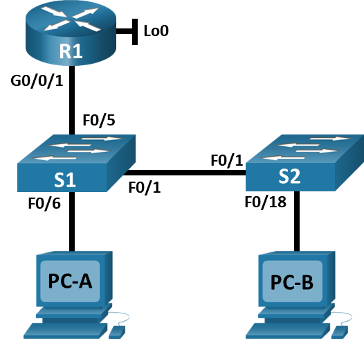

# Лабораторная работа. Конфигурация безопасности коммутатора

##  Топология

##  Таблица адресации

<table><thead>
    <th style="text-align: center;">Устройство</th>
    <th style="text-align: center;">Интерфейс</th>
    <th style="text-align: center;">IP-адрес</th>
    <th style="text-align: center;">Маска подсети</th>
</thead>
<tbody>
<tr>
    <th rowspan="2" style="text-align: center;">R1</th>
    <th style="text-align: center;">G0/0/1</th>
    <th style="text-align: center;">192.168.10.1</th>
    <th style="text-align: center;">255.255.255.0</th>
  </tr>
<tr>
    <th style="text-align: center;">Loopback 0</th>
    <th style="text-align: center;">10.10.1.1</th>
    <th style="text-align: center;">255.255.255.0</th>
  </tr>
<tr>
    <th style="text-align: center;">S1</th>
    <th style="text-align: center;">VLAN 10</th>
    <th style="text-align: center;">192.168.10.201</th>
    <th style="text-align: center;">255.255.255.0</th>
  </tr>
  <tr>
    <th style="text-align: center;">S2</th>
    <th style="text-align: center;">VLAN 10</th>
    <th style="text-align: center;">192.168.10.202</th>
    <th style="text-align: center;">255.255.255.0</th>
  </tr>
  <tr>
    <th style="text-align: center;">PC-A</th>
    <th style="text-align: center;">NIC</th>
    <th style="text-align: center;">DHCP</th>
    <th style="text-align: center;">255.255.255.0</th>
  </tr>
  <tr>
    <th style="text-align: center;">PC-B</th>
    <th style="text-align: center;">NIC</th>
    <th style="text-align: center;">DHCP</th>
    <th style="text-align: center;">255.255.255.0</th>
  </tr>
</tbody>
</table>

## Задачи

Часть 1. Создание сети и настройка основных параметров устройства\
Часть 2. Настройка сетей VLAN\
Часть 3. Настройка безопасности коммутатора\

## Выполнение работы

### Часть 1.  Настройка основного сетевого устройства

#### Шаг 1 Создаем топологию сети

#### Шаг 2 Настройка маршрутизатора R1

#### Шаг 3 Настройка базовых параметров коммутаторов

### Часть 2. Настройка VLAN на коммутаторах

#### Шаг 1 Конфигурация VLAN 10

#### Шаг 2 Конфигурация SVI VLAN 10

#### Шаг 3 Настройка VLAN 333 с именем Native на S1 и S2

#### Шаг 4 Настройка VLAN 999 с именем ParkingLot на S1 и S2

### Часть 3. Настройки безопасности коммутатора

#### Шаг 1 Реализация магистральных соединений 802.1Q

#### Шаг 1 Определие коммутатора с заблокированным протом. 

#### Шаг 2 Настройка портов доступа 

#### Шаг 3 Безопасность неиспользуемых портов коммутатора

#### Шаг 4 Документирование и реализация функций безопаности порта

<table>
<thead>
    <th colspan="2" style="text-align: center;">Конфигурация безопаности порта по умолчанию
<thead>
    <th style="text-align: center;">Функция</th>
    <th style="text-align: center;">Настройка по умолчанию</th>
</thead>
<tbody>
<tr>
    <th style="text-align: center;">Защита портов</th>
    <th style="text-align: center;"></th>
  </tr>
<tr>
    <th style="text-align: center;">Максимальное количество записей MAC-адресов</th>
    <th style="text-align: center;"></th>
  </tr>
<tr>
    <th style="text-align: center;">Режим проверки на нарушение безопасности</th>
    <th style="text-align: center;"></th>
  </tr>
  <tr>
    <th style="text-align: center;">Aging Time</th>
    <th style="text-align: center;"></th>
  </tr>
  <tr>
    <th style="text-align: center;">Secure Static Address Aging</th>
    <th style="text-align: center;"></th>
  </tr>
  <tr>
    <th style="text-align: center;">Sticky MAC Address</th>
    <th style="text-align: center;"></th>
  </tr>
</tbody>
</table>

#### Шаг 5 Реализация безопаности DHCP snooping

#### Шаг 6 Реализация PortFast и BPDU Guard

#### Шаг 7 Проверка сквозного подключения

## Вопросы для повторения 

1. С точки зрения безопасности порта на S2, почему нет значения таймера для оставшегося возраста в минутах, когда было сконфигурировано динамическое обучение - sticky? \
  **Ответ**:
2. Что касается безопасности порта на S2, если вы загружаете скрипт текущей конфигурации на S2, почему порту 18 на PC-B никогда не получит IP-адрес через DHCP? \
  **Ответ**:
3. Что касается безопасности порта, в чем разница между типом абсолютного устаревания и типом устаревание по неактивности? \
  **Ответ**:
  