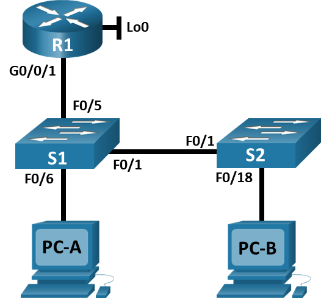
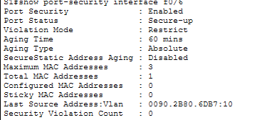
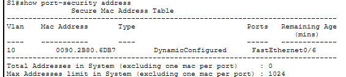
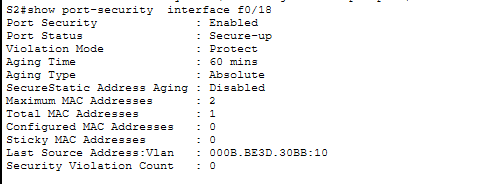
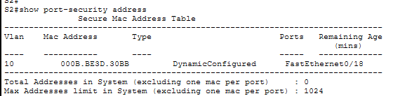
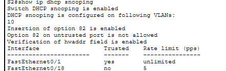
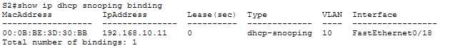
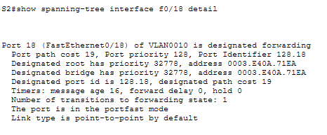
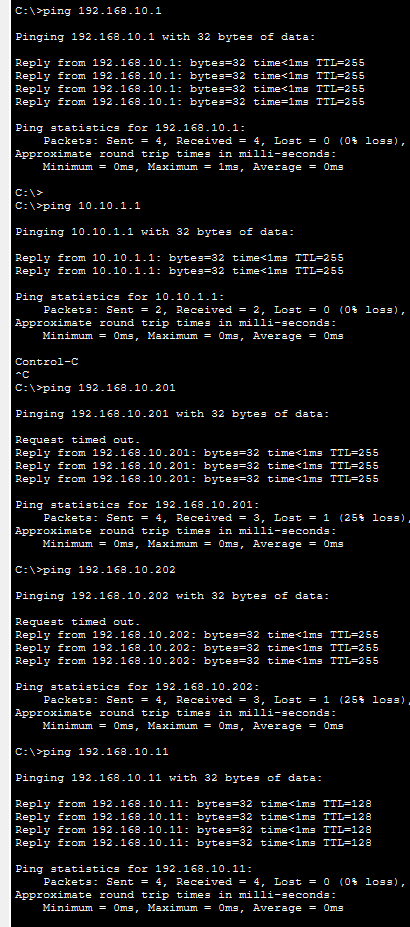
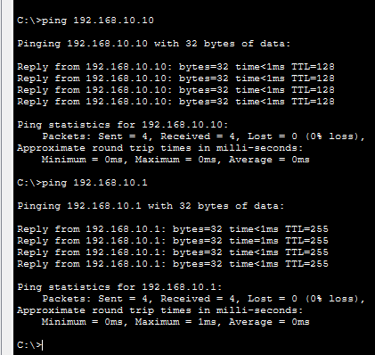

# Лабораторная работа. Конфигурация безопасности коммутатора

##  Топология

##  Таблица адресации

<table><thead>
    <th style="text-align: center;">Устройство</th>
    <th style="text-align: center;">Интерфейс</th>
    <th style="text-align: center;">IP-адрес</th>
    <th style="text-align: center;">Маска подсети</th>
</thead>
<tbody>
<tr>
    <th rowspan="2" style="text-align: center;">R1</th>
    <th style="text-align: center;">G0/0/1</th>
    <th style="text-align: center;">192.168.10.1</th>
    <th style="text-align: center;">255.255.255.0</th>
  </tr>
<tr>
    <th style="text-align: center;">Loopback 0</th>
    <th style="text-align: center;">10.10.1.1</th>
    <th style="text-align: center;">255.255.255.0</th>
  </tr>
<tr>
    <th style="text-align: center;">S1</th>
    <th style="text-align: center;">VLAN 10</th>
    <th style="text-align: center;">192.168.10.201</th>
    <th style="text-align: center;">255.255.255.0</th>
  </tr>
  <tr>
    <th style="text-align: center;">S2</th>
    <th style="text-align: center;">VLAN 10</th>
    <th style="text-align: center;">192.168.10.202</th>
    <th style="text-align: center;">255.255.255.0</th>
  </tr>
  <tr>
    <th style="text-align: center;">PC-A</th>
    <th style="text-align: center;">NIC</th>
    <th style="text-align: center;">DHCP</th>
    <th style="text-align: center;">255.255.255.0</th>
  </tr>
  <tr>
    <th style="text-align: center;">PC-B</th>
    <th style="text-align: center;">NIC</th>
    <th style="text-align: center;">DHCP</th>
    <th style="text-align: center;">255.255.255.0</th>
  </tr>
</tbody>
</table>

## Задачи

Часть 1. Создание сети и настройка основных параметров устройства\
Часть 2. Настройка сетей VLAN\
Часть 3. Настройка безопасности коммутатора\

## Выполнение работы

### Часть 1.  Настройка основного сетевого устройства

#### Шаг 1 Создаем топологию сети

#### Шаг 2 Настройка маршрутизатора R1

#### Шаг 3 Настройка базовых параметров коммутаторов

### Часть 2. Настройка VLAN на коммутаторах

#### Шаг 1 Конфигурация VLAN 10

#### Шаг 2 Конфигурация SVI VLAN 10

#### Шаг 3 Настройка VLAN 333 с именем Native на S1 и S2

#### Шаг 4 Настройка VLAN 999 с именем ParkingLot на S1 и S2

### Часть 3. Настройки безопасности коммутатора

#### Шаг 1 Реализация магистральных соединений 802.1Q

#### Шаг 1 Определие коммутатора с заблокированным протом. 

#### Шаг 2 Настройка портов доступа 

#### Шаг 3 Безопасность неиспользуемых портов коммутатора

#### Шаг 4 Документирование и реализация функций безопаности порта

<table>
<thead>
    <th colspan="2" style="text-align: center;">Конфигурация безопаности порта по умолчанию
<thead>
    <th style="text-align: center;">Функция</th>
    <th style="text-align: center;">Настройка по умолчанию</th>
</thead>
<tbody>
<tr>
    <th style="text-align: center;">Защита портов</th>
    <th style="text-align: center;">disabled</th>
  </tr>
<tr>
    <th style="text-align: center;">Максимальное количество записей MAC-адресов</th>
    <th style="text-align: center;">1</th>
  </tr>
<tr>
    <th style="text-align: center;">Режим проверки на нарушение безопасности</th>
    <th style="text-align: center;">Shutdown</th>
  </tr>
  <tr>
    <th style="text-align: center;">Aging Time</th>
    <th style="text-align: center;">0</th>
  </tr>
  <tr>
    <th style="text-align: center;">Secure Static Address Aging</th>
    <th style="text-align: center;">Disabled</th>
  </tr>
  <tr>
    <th style="text-align: center;">Sticky MAC Address</th>
    <th style="text-align: center;">0</th>
  </tr>
</tbody>
</table>

Для реализации заданных работой настроек используем следующие команды:
 - Максимальное количество записей MAC-адресов: 3
>switchport port-security maximum 3
- Режима безопасности: restrict
>switchport port-security violation restrict
- Aging time: 60 мин.
>switchport port-security aging time 60
- Aging type: неактивный
>switchport port-security aging type inactivity 

Последняя настройка недоступна в Cisco PT 9.0.1, поэтому значение характеристики остается выставленным по умолчанию как absolute, то есть устаревание соединение производится строго по истечению 60 минут. 

**Вывод команды show port-security interface f0/6:**
\

\

Повторим аналогичные шаги для порта f0/18 на S2

**Результат настройки для f0/18**
\

\

#### Шаг 5 Реализация безопаности DHCP snooping

**Пример реализации DHCP snooping для S2:**

- Включение DHCP snooping 
>conf t\
ip dhcp snooping
- Настройка DHCP snooping для VLAN 10
>ip dhcp snooping vlan 10
- Настройка магистрального порта как доверенного
>interface f0/1\
ip dhcp snooping trust
- Ограничение ненадежного порта f0/18 пятью DHCP-пакетами в секунду
>interface f0/18\
ip dhcp snooping limit rate 5
- Вывод настройки DHCP snooping на устройстве
\

Результат отличается от примера в работе, потому что не все характеристики выводятся в Cisco PT. 
\
- Вывод отслеживания привязки DHCP 
\

#### Шаг 6 Реализация PortFast и BPDU Guard

Пример настройки PortFast и ВPDU Guard
- Настройка portfast на интерфейсе доступа
>spanning-tree portfast
- Настройка portfast на всех включенных интерфейсах:
>(сofing)# spanning-tree portfast
- Настройка bpduguard на интерфейсе
>(config-if) spanning-tree bpduguard enable
- Настройка bpduguard на всех включенных интерфейсах доступа
>spanning-tree portfast bpduguard default 

**Результат настройки на интерфейсе f0/18:**
\

\
Команда не выводит настройку bpduguard, хотя она включена. Вероятно, ограничение Cisco PT. 

#### Шаг 7 Проверка сквозного подключения

**Проверка доступности устройств с PC-A:**
\

\
**Проверка доступности устройств с PC-B:**
\

Устройства доступны, сеть настроена верно. 

Конфигурации устройств: [R1](configs/R1) [S1](configs/S1) [S2](configs/S2)

## Вопросы для повторения 

1. С точки зрения безопасности порта на S2, почему нет значения таймера для оставшегося возраста в минутах, когда было сконфигурировано динамическое обучение - sticky? \
  **Ответ**: Значение sticky закрепляется как статическая запись в конфигурация и считается постоянной, то есть не подверженной старению. 
2. Что касается безопасности порта на S2, если вы загружаете скрипт текущей конфигурации на S2, почему порту 18 на PC-B никогда не получит IP-адрес через DHCP? \
  **Ответ**: Из-за функции sticky MAC PC-B не сможет получить конфигурации, если его количество доступных MAC уже исчерпано и на PC-B не получит DHCP запрос, потому что его запрос будет заблокирован на порту. 
3. Что касается безопасности порта, в чем разница между типом абсолютного устаревания и типом устаревание по неактивности? \
  **Ответ**: absolute обозначает режим работы, где таймер работает и сбрасывает соединение вне зависимости от активности подключения. Inactivity предполагает работу таймера только в случае отсутствия активности подключения. 
  